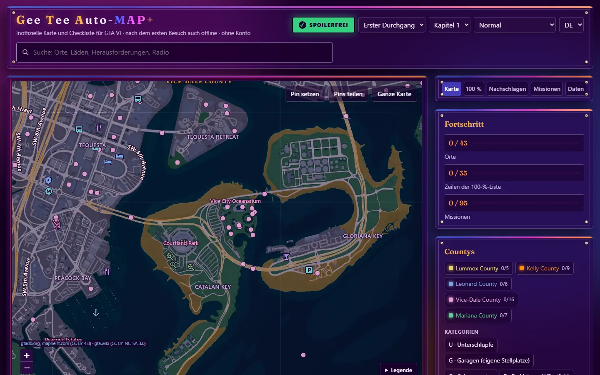

# Gee Tee Auto-MAP+

Meine inoffizielle Fan-Karte und Checkliste für GTA VI: https://dennismit2n.github.io/auto-map/

Nicht verbunden mit Rockstar Games oder Take-Two Interactive. Grand Theft Auto ist eine Marke von Take-Two Interactive. Kostenlos, ohne Werbung, ohne Konto.

Im Browser, auf Deutsch und Englisch, nach dem ersten Besuch auch offline. Orte und Läden aus gtadb.org, eine Suche für alles, die 100-%-Liste, Missionen, Nachschlagen, eigene Pins zum Teilen per Link und ein Schalter, der alles nach deinem Kapitel verbirgt. Dein Fortschritt liegt nur in deinem Browser.

## Quellen und Lizenzen

- Kartenbild und Orte: GTA VI Map Tiles und Landmarks Data von [gtadb.org](https://map.gtadb.org) and contributors, [CC BY 4.0](https://creativecommons.org/licenses/by/4.0/). Geändert: auf das Raster dieser Karte gelegt, dunkel umgefärbt, Auswahl der Orte.
- Schauplätze: [mapheist.com](https://mapheist.com/en/data/), CC BY 4.0. Geändert: nur Einträge mit Lage, umgerechnet.
- Straßennamen: [gta.wiki](https://gta.wiki/w/List_of_Street_Names), [CC BY-NC-SA 3.0](https://creativecommons.org/licenses/by-nc-sa/3.0/). Die Datei data/strassen.json steht unter derselben Lizenz.
- Kartenbibliothek: Leaflet (BSD 2-Clause, vendor/leaflet/LICENSE). Schrift: Fraunces (OFL, assets/fonts/OFL.txt).

Dieses Repo enthält nur die ausgelieferten Dateien. Löschwünsche und Hinweise bitte als Issue in diesem Repo.
